# Protect Probashi

Protect Probashi is a Bangla and English information app for Bangladeshi workers living abroad. It brings together emergency contacts, Bangladesh mission listings, worker guidance, expatriate news and currency conversion to Bangladeshi taka.

The project is a React single-page application built with Vite. It can be deployed as a static site on Vercel and includes a production service worker for offline access to cached app content.

## Features

- One-click language switching, with the selected language displayed first in the bilingual brand.
- Country and city search in Bangla or English, plus manual selectors. The current location screen does not request GPS permission.
- Emergency service numbers for countries with verified data and published embassy contacts.
- A directory of 82 Bangladesh offices across 60 countries, including embassies, consulates, high commissions and permanent missions.
- Country filtering and prioritisation of offices matching the selected country and city.
- Worker-rights pages with links to relevant help sections.
- News summaries in both languages, publisher-hosted images, photo credits, publication dates and original source links.
- A compact currency converter covering the currencies returned by the provider, with a daily rate timestamp, local caching and explicit stale-rate handling.
- Offline access to previously cached app assets and bundled data.

## Current content limits

The directory's coverage is broader than its verified contact coverage. Five records in `src/data/embassies.json` contain verified contact details. Most imported mission records have no phone number, address or email. Missing details are displayed as unverified.

Verified emergency data currently covers Saudi Arabia, the United Arab Emirates and Qatar. Selecting another country does not create emergency numbers for it.

The rights content is still sample material requiring country-specific source checking and review before it is used as practical guidance. Incorrect-information reporting has no configured contact method yet.

News is maintained manually. There is no scheduled news importer or automatic translation pipeline. Images remain on publisher servers and may become unavailable.

Currency values are daily reference rates. Bank and remittance-service payouts can differ, and fees or incentives are not included. The app shows the provider's update timestamp rather than assuming every response is current.

## Local setup

Use a Node.js version supported by the installed Vite release; Node.js 22.12 or a newer supported LTS release is suitable.

```bash
npm ci
npm run dev
```

Open the local URL printed by Vite. No API key or environment variables are required for the current implementation.

## Checks and production preview

```bash
node --test tests/*.test.js
npm run build
npm run preview
```

Tests cover mission normalization and deduplication, verified-record precedence, bilingual location search, news metadata and currency calculations/cache behavior. Legacy geolocation utility tests remain, although GPS detection is no longer exposed in the location UI.

`npm run build` generates `dist/`. The production build includes PWA assets and the service worker. Offline behavior should be checked against a production preview or deployed site, after an initial online visit.

## Application routes

| Route | Purpose |
| --- | --- |
| `/` | Home dashboard and currency converter |
| `/location` | Country and optional city selection |
| `/emergency` | Selected-country emergency and embassy contacts |
| `/embassy` | Full mission directory and country filter |
| `/rights` | Available worker guidance |
| `/rights/:id` | Individual guidance page |
| `/news` | News list and filters |
| `/news/:id` | Summary, image and publisher reference |
| `/about` | Purpose, limitations, privacy and reporting status |

## Workflow

The diagram below covers user navigation, content maintenance, currency fetching, offline behavior and deployment. The standalone Mermaid source is [docs/workflow.mmd](docs/workflow.mmd).

```mermaid
flowchart TD
    Visitor["Worker opens Protect Probashi"] --> Hosting["Vercel: Vite app and serverless APIs"]
    Hosting --> Router["React BrowserRouter"]
    Router --> Preferences["Bangla or English; saved country and current city"]
    Preferences --> Shell["Bilingual header, navigation and RSS news ticker"]
    Shell --> Home["Home: services, news preview and currency"]
    Home --> Location["Search and select country or city"]
    Emergency --> Location
    Location --> Save["Save country on device; set current city"]
    Save --> Return["Return to requested page; otherwise Home"]
    Return --> Emergency
    Return --> Home
    Home --> Emergency["Emergency: country services and curated embassy contacts"]
    Home --> Embassy["Embassy: search and country filter; expand office for details and officers"]
    Home --> Rights["Rights: global and selected-country guidance"]
    Rights --> RightsDetail["Guidance detail and help links"]
    Home --> News["News: filters and pagination; 12 cards on large screens, 6 otherwise"]
    News --> NewsDetail["Original feed headline and excerpt or curated summary; image, time and source"]
    NewsDetail --> Publisher["Full article on publisher website"]
    Shell --> About["About: purpose, limitations and privacy"]
    Home --> ClockPage["Clock and weather; side by side on large screens"]

    subgraph Content["Content maintenance"]
        Editors["Maintainer checks official sources"] --> Curated["embassies.json: curated contact records"]
        Editors --> Missions["bd_missions.json: global mission directory"]
        MissionSync["Mission scraper: discover official sites and contact pages"] --> MissionMerge["Fill missing fields; preserve values; record conflicts and sources"]
        MissionMerge --> Missions
        MissionMerge --> Backups["Timestamped backups, previews and reports"]
        EmergencySync["Emergency scraper: government travel advice for configured countries"] --> Numbers["emergency_numbers.json: sourced numbers and separately marked user additions"]
        EmergencySync --> Backups
        Editors --> CountryData["countries.json: curated countries and emergency data"]
        CountryData --> Countries["Merge countries, mission cities and emergency-only countries"]
        Missions --> Countries
        Numbers --> Countries
        Countries --> Location
        Countries --> Emergency
        Curated --> Merge["Normalize missions and deduplicate; curated records take precedence"]
        Missions --> Merge
        Countries --> Merge
        Merge --> Embassy
        Details["mission_details.json: reviewed optional additions"] --> Embassy
        Curated --> Emergency
        Countries --> Embassy
        Editors --> RightsData["rights.json: currently sample guidance"]
        RightsData --> Rights
        RightsData --> RightsDetail
    end

    subgraph NewsFlow["RSS and curated news"]
        Feeds["Prothom Alo Bangla and English RSS"] --> NewsAPI["GET /api/news: fetch feeds independently; 15-minute server cache"]
        NewsAPI --> Normalize["Normalize feed excerpts, images and attribution; reject future and older-than-seven-day articles"]
        Normalize --> NewsCache["useNews: 15-minute device cache; deduplicate and sort"]
        CuratedNews["news.json: published, nonexpired curated reports"] --> NewsCache
        NewsCache --> News
        NewsCache --> NewsDetail
        NewsCache --> Shell
        NewsCache --> Home
        NewsAPI -->|Unavailable| SavedNews["Use saved news and curated reports"]
        SavedNews --> NewsCache
    end

    subgraph Currency["Currency conversion to BDT"]
        Home --> LoadRates["Load exchange rates"]
        LoadRates --> Fresh{"Fresh device cache?"}
        Fresh -->|Yes| Convert["Select amount and currency; convert to BDT"]
        Fresh -->|No| Primary["ExchangeRate-API v4; USD base; timeout"]
        Primary -->|Valid and fresh| NormalizeRates["Normalize USD rates to BDT base; cache on device"]
        Primary -->|Failed, invalid or stale| Fallback["GET /api/exchange-rates: Open Exchange Rates; server-side App ID"]
        Fallback -->|Valid and fresh| NormalizeRates
        Fallback -->|Unavailable| CacheCheck{"Saved rates available?"}
        CacheCheck -->|Yes| Stale["Show saved rates with stale notice"]
        CacheCheck -->|No| Retry["Error and retry button"]
        Retry --> LoadRates
        Stale --> Convert
        NormalizeRates --> Convert
        Convert --> Display["BDT result, active provider and Bangladesh-time timestamp"]
    end

    subgraph TimeWeather["Clock and weather"]
        ClockPage --> Clocks["Pinned Dhaka; add or remove city clocks; save on device"]
        Clocks --> TimeZones["Intl time zones: live local time, DST and difference from Dhaka"]
        ClockPage --> CitySearch["Weather city search; defaults to Dhaka"]
        CitySearch --> Geocoding["Open-Meteo geocoding: choose matching city"]
        Geocoding --> Forecast["Open-Meteo forecast: temperature, humidity, wind and three-day highs/lows"]
        Forecast --> WeatherDisplay["Local weather time and provider attribution"]
        Forecast -->|Failure| WeatherRetry["Unavailable notice and retry"]
    end

    subgraph Offline["Offline behavior"]
        Hosting --> SW["Production service worker precaches matched app assets and bundled JSON"]
        SW --> Router
        SW --> Limits["Remote news images, hero PNG and weather are not precached"]
        SavedNews --> OfflineNews["Previously saved feed text remains available"]
        Stale --> OfflineRates["Saved currency rates remain available"]
        Clocks --> OfflineClock["Clock calculation works offline using device time"]
    end

    subgraph Release["Development and release"]
        Changes["Code or data changes"] --> Tests["Node regression tests; Python scraper tests when relevant"]
        Tests --> Build["Vite production build"]
        Build --> Git["Commit and push to GitHub"]
        Git --> Deploy["Vercel build; SPA rewrites exclude API routes"]
        Deploy --> Hosting
        Secret["Vercel environment: OPEN_EXCHANGE_RATES_APP_ID"] --> Fallback
        Local["Vite development middleware"] --> NewsAPI
    end
```



## Project structure

```text
src/
  components/        Shared UI, header, ticker and currency converter
  data/              Country, embassy, mission, rights and news JSON
  hooks/             Language, country and online-state contexts/hooks
  i18n/              Bangla and English interface text
  pages/             Route-level views
  utils/             Content formatting, mission merge, search and rate loading
  App.jsx            Providers, layout and routes
  main.jsx           App entry point and service-worker registration
tests/               Node regression tests
docs/workflow.mmd    Mermaid workflow source
vercel.json          Build settings and SPA routing
vite.config.js       React and PWA build configuration
```

## Updating content

### Countries and mission contacts

`src/utils/directoryCountries.js` combines the curated country data with countries and cities represented in the imported mission list. It does not infer emergency numbers for additional countries.

`src/utils/missions.js` normalizes imported missions into the existing schema and merges them with the verified embassy records. Verified records take precedence. Offices are matched by country, city and role, so the Jeddah consulate and the OIC permanent mission remain separate.

Update `src/data/embassies.json` for verified contacts. Preserve a stable ID, bilingual name, country code, city ID, mission type, source URL and the actual date of verification. Do not assign a verification date just because a mission appears in a directory.

### Worker guidance

Maintain `src/data/rights.json` with short bilingual instructions. Replace the sample content only after checking relevant official sources. Include the review date and appropriate contact destinations.

### News

Maintain `src/data/news.json`. Each published story should have:

- A unique ID and `status: "published"`.
- Bangla and English titles and short summaries.
- `countryCodes`, using an empty array for worldwide stories.
- `sourceName`, an HTTPS `sourceUrl` and the original `publishedAt` date.
- An optional expiry date and a carefully chosen urgent flag.
- An HTTPS image URL, bilingual alternative text and an image credit when using an image.

The app excludes drafts, future-dated posts and expired stories. It sorts eligible stories newest first, then applies the relevant country filter. Use short summaries and link readers to the original report. Check publisher permissions before expanding image reuse or automated ingestion.

### Currency rates

`src/utils/exchangeRates.js` requests `https://open.er-api.com/v6/latest/BDT`. Since the response is based on one BDT, foreign-currency amounts are divided by the selected rate to produce BDT.

Valid cached rates are reused until the provider's next-update time. Requests have a timeout. If a request fails, a saved response can be displayed with an explicit stale warning; without saved data, the panel shows an error and retry action.

Provider attribution is included in the UI. See the [ExchangeRate-API open-access documentation](https://www.exchangerate-api.com/docs/free).

## Privacy and offline behavior

There is no account requirement. Language and country preferences, plus cached currency data, are stored locally. The selected city is kept in application state and is not restored after a full reload.

News images and currency requests contact external providers. The production service worker caches app assets and bundled JSON; it does not guarantee offline availability of publisher images or fresh exchange rates.

The home-page offline action checks whether the production app cache is available. It does not download every remote image or force a rate refresh.

## Deploying to Vercel

Push the repository to GitHub and import it into Vercel. Use these settings:

| Setting | Value |
| --- | --- |
| Framework | Vite |
| Root directory | Directory containing `package.json` |
| Build command | `npm run build` |
| Output directory | `dist` |
| Environment variables | None currently required |

`vercel.json` includes a rewrite to `index.html` so direct visits and refreshes on routes such as `/embassy` work.

After deployment, check direct route refreshes, language switching, location confirmation, source links, currency loading and offline reopening. Subsequent pushes trigger deployments when the repository is connected to the Vercel project.

## Contribution workflow

```bash
npm ci
node --test tests/*.test.js
npm run build
git add README.md docs/workflow.mmd
git commit -m "Document project setup and application workflow"
git push origin main
```

For application changes, stage the relevant source and test files as well. Dependencies, generated builds, virtual environments, logs, local Vercel settings and environment secrets are excluded by `.gitignore`.

### Currency providers

ExchangeRate-API v4 (USD base) is the default. If it fails, returns invalid data, or returns stale rates, the app tries Open Exchange Rates through `/api/exchange-rates`. Both responses are converted to the app's BDT-based format. If both fail, cached rates remain available with a stale notice.

Set `OPEN_EXCHANGE_RATES_APP_ID` in Vercel's environment variables and redeploy to enable the fallback. Keep it server-side; do not prefix it with `VITE_`. No key is needed for the default provider. The fallback uses USD base so it works with the Open Exchange Rates free plan. Browser results are cached for up to a day; the fallback endpoint has a one-hour shared cache.

For local fallback testing, use `vercel dev` with the environment variable configured. Plain `npm run dev` serves the frontend and default provider but does not run Vercel API functions.

### RSS news

`/api/news` reads Prothom Alo's Bangla and English RSS feeds. The home cards, news pages and ticker share the results. Original headlines, publisher-provided feed excerpts, available media images, source links and publication timestamps are retained; full linked articles are not scraped or translated. Only articles from the last seven days are imported. Feeds refresh on requests after a 15-minute cache expires. Browser storage provides saved news when offline, with curated articles as a further fallback.

The API works on Vercel and through the included Vite development middleware. No API key or scheduled job is required. Configure publishers in `api/news.js`; unavailable images are hidden, and feed failures do not remove curated news.
